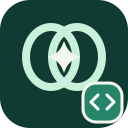

<p align="center"></p>

# Ownference Web — Let users bring their own AI.

A small browser SDK and accessible local demo for applications that cooperate with a user's local models. Your app explicitly connects to the user's Ownference runtime; it does not proxy requests through your server or silently switch to a cloud model.


## Try the workspace

Requires Node.js 24+, [Ollama](https://ollama.com/) running locally with a downloaded model, and the sibling [Ownference runtime](https://github.com/edwinjosechittilappilly/ownference). Clone this repository with `gh repo clone edwinjosechittilappilly/ownference-web`, enter it and run `npm ci`. Keep the runtime checkout beside it. In separate terminals:

```sh
ollama serve                         # skip if already running
ollama pull llama3.2                 # skip if already installed
cd ../ownference
node src/cli.js grant --origin http://localhost:4173
node src/cli.js serve
```

The grant prints a token **once**. Copy it securely. From this repository:

```sh
npm start
```

Open **http://localhost:4173**, paste the token and choose **Connect & find models**. Pick a model and task, paste source text, optionally add direction, and generate. Copy or download the result, cancel a stream, clear the workspace, or disconnect. The token is cleared from the input on connection and retained only in page memory; reloading or disconnecting requires a new paste. Revoke access with `node src/cli.js revoke --origin http://localhost:4173` in the runtime repository. A token is not a password for sharing: anyone holding it can use the associated grant.

The demo binds loopback and exposes only explicitly listed static assets. `PORT=... npm start` changes the port; grant that exact origin instead. `localhost` and `127.0.0.1` are different origins. The demo uses the default runtime address `http://127.0.0.1:3210`.

## Integrate the SDK

The package is private until publication. For local development, install from a sibling checkout with `npm install ../ownference-web` or import `src/index.js` using your bundler. It is ESM and ships TypeScript declarations. Your UI must ask the user to enter an origin-scoped token; never put it in source, a URL, logs, or persistent browser storage. Grant the exact origin of your application with the runtime CLI.

```js
import { createClient, OwnferenceError } from '@ownference/web';

// Obtain this value explicitly from a password input in your own UI.
const token = document.querySelector('#token').value;
document.querySelector('#token').value = '';
const client = createClient({ token });
const { models } = await client.models();
if (!models.length) throw new Error('No local models available');
const controller = new AbortController();
document.querySelector('#cancel').addEventListener('click', () => controller.abort());
const result = document.querySelector('#result');
try {
  for await (const delta of client.generate({
    model: models[0].id,
    task: 'summarize', // also rewrite, extract, compare, draft
    text: 'Text supplied by the user',
    instruction: 'Use one sentence.' // optional
  }, { signal: controller.signal })) {
    result.textContent += delta; // Never treat model output as HTML.
  }
} catch (error) {
  if (error instanceof OwnferenceError) console.error(error.code, error.message);
  else throw error;
}
```

`createClient({token, baseUrl?})` defaults to `http://127.0.0.1:3210`; only HTTP loopback origins are accepted. `models({signal?})` returns `{models, providers?}`. `generate(input, {signal?})` returns an async iterable of text deltas and requires a terminal stream record. `OwnferenceError` exposes `code`, `message`, optional HTTP `status`, and sometimes `cause`. Network failures explain likely origin, local-network, and runtime causes; server errors preserve their safe code and message. Cancellation reports `ABORTED`. Stop iteration early or abort to cancel the response. Input limits are enforced by the runtime: 24,000 characters for text and 2,000 for instruction.

## Browser and security boundaries

This is a cooperating frontend integration, not universal website interception. Each browser request goes **directly from the user's browser** to their own loopback runtime. A server-side request to localhost would reach the server, not the user's computer. The runtime validates the exact origin and bearer token. The browser may also block local-network or mixed-context access, particularly from a hosted HTTPS site or due to enterprise policy; behavior varies by browser and version. If blocked, use the localhost demo or provide appropriate browser-supported permissions; do not disable browser protections or weaken origin checks. The default demo CSP allows only the standard local bridge address.

No telemetry, external CDN, cloud fallback, automatic connection, tool execution or arbitrary URL fetching. Source text and instructions go to the selected local provider through the runtime; prompts and generated text can still be sensitive. Output and provider names are rendered as text, not HTML. See [SECURITY.md](SECURITY.md).

## Verify

`npm run check` runs deterministic HTTP SDK and static-server tests, including fragmented streams, failures, cancellation, path boundaries, and text rendering. `make check` is equivalent. For real Ollama acceptance, start the runtime and Ollama as above, then pass the grant token through your shell environment (avoid committing it):

```sh
read -rs OWNFERENCE_TOKEN; export OWNFERENCE_TOKEN; echo
npm run smoke
unset OWNFERENCE_TOKEN
```

The smoke test discovers an Ollama model and streams a real response; set `OWNFERENCE_MODEL=ollama:llama3.2:latest` to choose one, or `OWNFERENCE_URL` for a different loopback runtime port. It exits nonzero on failure and does not install or start a model for you. This check is separate from deterministic tests.

Apache-2.0 licensed. Ownference is a working name and has not been trademark-cleared.

## Build with confidence

- A small ESM interface with TypeScript declarations and strict consumer typechecks.
- Cancellable streaming with explicit network, protocol and provider errors.
- A real workspace for summarizing, rewriting, extracting, comparing and drafting.
- No runtime dependencies, tracking scripts or cloud fallback.

See [architecture](docs/architecture.md), [testing](docs/testing.md) and [observed verification](docs/verification.md). The planned [browser relay](https://github.com/edwinjosechittilappilly/ownference-tabs/blob/main/docs/browser-relay-plan.md) would offer extension-mediated frontend inference without exposing bridge tokens to page scripts. That transport is not implemented by this SDK.
