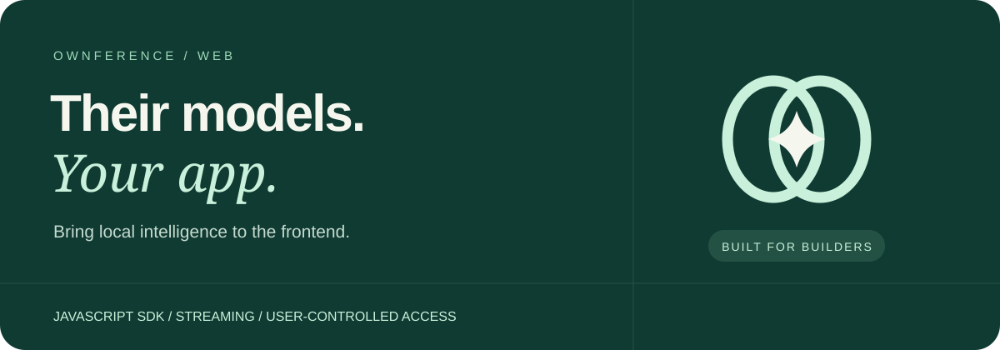
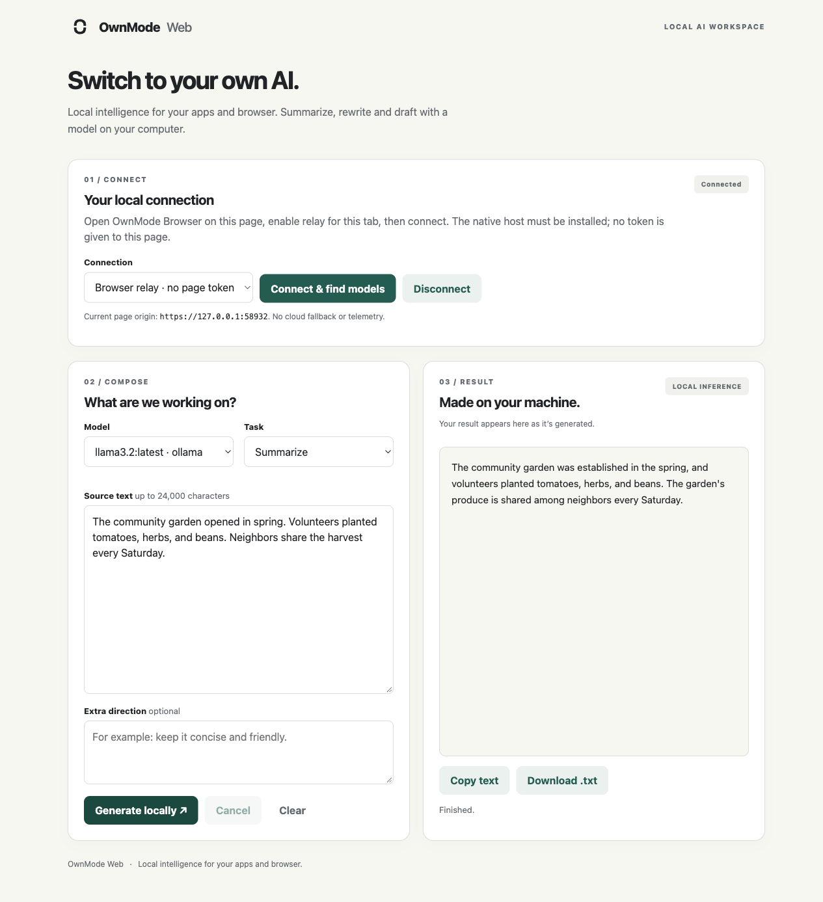

# OwnMode Web

**Switch to your own AI.** Local intelligence for your apps and browser.

A dependency-free JavaScript SDK, TypeScript declarations and a working writing workspace. Stream from the visitor's local models through direct loopback or an explicitly approved browser relay.

[](https://github.com/edwinjosechittilappilly/ownmode-web/actions/workflows/ci.yml)
[Apache-2.0](LICENSE) · [Try it](#try-it) · [SDK example](#add-local-ai-to-your-app) · [Releases](https://github.com/edwinjosechittilappilly/ownmode-web/releases/latest) · [Issues](https://github.com/edwinjosechittilappilly/ownmode-web/issues/new/choose)

## Try it

Start [OwnMode Connect](https://github.com/edwinjosechittilappilly/ownmode) with a ready local model. With **Node.js 24+**:

```sh
npx --yes --package https://github.com/edwinjosechittilappilly/ownmode-web/releases/download/v0.3.0/ownmode-web-0.3.0.tgz ownmode-web
```

Open **http://localhost:4173**. No GitHub login or global workspace install required. In another terminal:

```sh
ownmode grant --origin http://localhost:4173
```

Choose **Direct**, paste that token, connect and choose your model. Paste a paragraph, select Rewrite and generate.

Source and result stay separate. Watch the answer stream, cancel, copy or download it.



Want a durable command?

```sh
npm install -g https://github.com/edwinjosechittilappilly/ownmode-web/releases/download/v0.3.0/ownmode-web-0.3.0.tgz
ownmode-web
```

## Add local AI to your app

```sh
npm install https://github.com/edwinjosechittilappilly/ownmode-web/releases/download/v0.3.0/ownmode-web-0.3.0.tgz
```

For browser relay, the visitor installs [OwnMode Browser](https://github.com/edwinjosechittilappilly/ownmode-browser) and its native host, then approves your current tab. Call this from your **Connect** action after approval; this example expects Ollama's `llama3.2:latest` to be downloaded:

```js
import { createRelayClient } from '@ownmode/web';

const ai = createRelayClient();
await ai.connect();
try {
  for await (const delta of ai.generate({
    model: 'ollama:llama3.2:latest',
    task: 'rewrite',
    text: 'Thanks for waiting. We will get back to you soon.',
    instruction: 'Make it warm and concise.'
  })) {
    document.querySelector('#result').textContent += delta;
  }
} finally {
  ai.disconnect();
}
```

Use `await ai.models()` to populate your own model picker. Pass `{signal: abortController.signal}` as the second argument to `generate()` for a Cancel action. Render output as text, not HTML; surface errors instead of silently falling back to cloud inference.

**No bridge token goes into the relay page.** The extension and installed native host carry the authorized local connection.

### Prefer direct loopback?

```js
import { createClient } from '@ownmode/web';

const ai = createClient({ token: userSuppliedOriginToken });
const { models } = await ai.models();
```

Direct clients use the same streaming `generate()` interface; `baseUrl` can select another loopback bridge port. Keep tokens in memory, not URLs or analytics. A backend request to localhost reaches **your server**, not the visitor's computer.

## Choose your connection

| | Direct | Browser relay |
|---|---|---|
| User setup | Connect + exact-origin token | Connect + Browser + registered native host |
| Page holds bridge token | Yes | No |
| Authorization | Local grant command | Extension-owned approval for this document |
| Route | Browser fetch → loopback | Page channel → extension → native host |
| Constraint | Browser local-network/mixed-context policies | Chrome extension/native-host policies |

Neither transport intercepts another website's server-side AI. The workspace supports both: select **Browser relay** after approving its tab; the token field is hidden and unnecessary.

### Upgrading from Ownference

The new protocol and package names are a clean break. Uninstall the old startup service and native host using the old version's instructions, then set up OwnMode Connect and OwnMode Browser. Create new exact-origin grants and approve each browser tab again; old grants are not imported. Replace `@ownference/web`, `OwnferenceError` and the old CLI in your integration with `@ownmode/web`, `OwnModeError` and `ownmode-web`.

## Useful building blocks

- Five tasks: summarize, rewrite, extract, compare and draft.
- Async text deltas, cancellation and typed protocol/provider/network errors.
- No runtime npm dependencies, remote CDN or cloud credential.
- Strict stream framing, UTF-8 and terminal-record validation.
- Default bounds: 24,000 source characters and 2,000 instruction characters; a model's context window may be smaller.

<details>
<summary>Permission and privacy details</summary>

The selected local provider receives the prompt. Any website receiving output can transmit it elsewhere. Same-origin scripts share a granted site's permission; ask users to approve only sites they trust.

Relay approval is session-only and document-bound. Validated grants can survive ordinary worker idleness; active work is never replayed after a lost connection. Navigation/revoke removes access; browser/extension restart clears session grants.

No telemetry, arbitrary URL fetching, cloud fallback or model-executed tools. Generated output can be wrong. Enterprise/browser policies may prevent either connection.

</details>

## Build something worth sharing

Add a rewrite button to an editor, summarize selected research, compare two offers, or draft a reply for a user to review. Keep model choice and connection state visible.

[Share an integration or request an example](https://github.com/edwinjosechittilappilly/ownmode-web/issues/new/choose).

```sh
npm ci
npm run check
npm start
```

[Architecture](docs/architecture.md) · [Testing](docs/testing.md) · [Verification](docs/verification.md) · [Brand assets](docs/assets/README.md) · [Contributing](CONTRIBUTING.md) · [Security](SECURITY.md)

[Connect](https://github.com/edwinjosechittilappilly/ownmode) · [Web](https://github.com/edwinjosechittilappilly/ownmode-web) · [Browser](https://github.com/edwinjosechittilappilly/ownmode-browser) · [Mac](https://github.com/edwinjosechittilappilly/ownmode-mac)

Apache-2.0. GitHub release tarballs are not npm registry publications. No trademark clearance is claimed.
